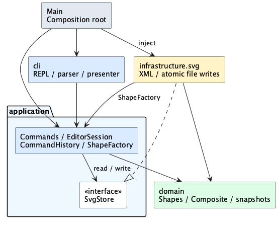

# SVG 编辑器架构与开发记录

本项目采用 TypeScript 和面向对象方式实现 Lab 1 Phase 1。领域层维护图形树和约束，应用层通过 Command 执行操作，外层负责终端交互与 SVG 文件读写。Command 和 Composite 是核心模式，快照负责撤销恢复，Visitor 支持按具体图形生成显示信息。

当前实现包含六种图形、十九条命令、快照历史、SVG 文件读写、命令解析和交互式 REPL。`npm run cli` 启动编辑器，也可从命令文件回放；导出的 SVG 可直接在浏览器打开。`npm run demo` 保留最初的固定流程演示。支持范围按本阶段要求限定，插件和 box 留在后续阶段。

## 架构方案

### 模块划分与目录

```text
.
├── package.json                 # 开发、测试、构建和演示脚本
├── package-lock.json            # 锁定实际安装版本
├── tsconfig.json                # 源码与测试的严格类型检查
├── tsconfig.build.json          # 仅编译源码到 dist
├── src/
│   ├── Main.ts                  # 组装 REPL、会话与文件适配器
│   ├── Demo.ts                  # 独立的固定流程演示
│   ├── cli/
│   │   ├── CliApplication.ts    # REPL、提示符、逐行等待执行
│   │   ├── CommandTokenizer.ts  # 空白、注释行与双引号
│   │   ├── CommandToken.ts      # 保留参数值和是否带引号
│   │   ├── CommandArguments.ts  # 参数数量与数值语法
│   │   ├── CommandFactory.ts    # 命令名到对象的唯一分派点
│   │   ├── CommandParser.ts     # 词法分析与工厂组合
│   │   └── ConsolePresenter.ts  # 统一输出结果和 error: 前缀
│   ├── application/
│   │   ├── EditorSession.ts     # 当前文档、路径、执行队列
│   │   ├── CommandHistory.ts    # undo/redo 与 IO 屏障
│   │   ├── CommandResult.ts     # 不可变输出 DTO
│   │   ├── ShapeFactory.ts      # 六种图形的唯一类型分派点
│   │   ├── ShapeDefinition.ts   # 创建参数和文本能力的内置元数据
│   │   ├── ApplicationError.ts
│   │   ├── commands/
│   │   │   ├── Command.ts
│   │   │   ├── UndoableCommand.ts
│   │   │   ├── edit/            # 十种编辑命令，各自一个类文件
│   │   │   ├── document/        # Init/Read/Save/Canvas
│   │   │   ├── query/           # Tree/Show/Help
│   │   │   └── history/         # Undo/Redo
│   │   ├── presentation/        # 图形摘要、tree、show 的格式化
│   │   └── ports/               # SvgStore、ReadDocumentResult
│   ├── domain/
│   │   ├── SvgDocument.ts       # 画布、根节点、ID 索引、结构操作
│   │   ├── DocumentSnapshot.ts  # 隔离的完整图形树快照
│   │   ├── Shape.ts             # 图形抽象基类
│   │   ├── ShapeContainer.ts    # 根文档与 Group 共用的容器接口
│   │   ├── ShapeVisitor.ts
│   │   ├── Geometry.ts          # 数值属性与整批更新校验
│   │   ├── ShapeStyle.ts        # 可选样式及其校验
│   │   ├── Rect.ts
│   │   ├── Circle.ts
│   │   ├── Ellipse.ts
│   │   ├── Line.ts
│   │   ├── Text.ts
│   │   ├── Group.ts
│   │   ├── DomainError.ts
│   │   └── internal/           # 数值校验、树关系修改能力
│   └── infrastructure/
│       └── svg/                # SvgReader、SvgWriter、SvgWriterVisitor、XmlSvgStore
├── tests/
│   ├── cli/                    # 词法、语法、REPL、终端输出
│   ├── domain/                 # 几何、树约束、快照
│   ├── application/            # 命令事务、历史、显示
│   ├── integration/            # 存储接口协作、依赖规则
│   ├── infrastructure/         # 真实 XML 编解码、文件事务
│   └── fixtures/               # 测试适配器、CLI 子进程、典型会话和 SVG
├── examples/                   # 可回放流程图脚本与实际导出文件
└── doc/
    ├── README.md
    ├── architecture.puml       # 可编辑的组件图源文件
    ├── architecture.png        # PlantUML 本地渲染结果
    └── flowchart-preview.jpg   # 实际浏览器渲染截图
```

| 模块 | 职责 | 不承担的职责 |
| --- | --- | --- |
| `domain` | 封装图形状态、几何行为、样式和树结构约束 | 读取终端、文件操作、XML 解析、撤销栈 |
| `application` | 执行命令、管理会话及历史、生成显示结果、定义存储接口 | 直接打印、绑定具体 XML 库或文件系统 |
| `cli` | 逐行读取、命令解析、提示符和终端输出 | 计算几何、直接修改树结构 |
| `infrastructure/svg` | XML 编解码、文件读取和原子保存 | 命令业务、终端交互 |
| `Main` / `Demo` | 创建并连接对象，运行入口流程 | 图形业务规则 |

`Main` 将共享的 `ShapeFactory` 注入会话、命令工厂和 `XmlSvgStore`，并启动 `CliApplication`。所有计划中的核心模块均已有实际实现，不通过空类伪装已完成模块。

以下组件图由 [PlantUML 源码](architecture.puml) 在本地渲染，箭头表示源码依赖，虚线三角表示实现接口：



源码采用 `!pragma layout smetana`，不依赖外部 Graphviz。PNG 已提交，阅读文档不需要安装 Java 或 PlantUML；需要更新图时，可在本机执行 `java -jar plantuml.jar -tpng doc/architecture.puml`。

### 核心对象与树约束

`Shape` 封装不可变 ID、父容器、几何数据和样式，公开只读视图及有意义的行为。`Rect`、`Circle`、`Ellipse`、`Line`、`Text`、`Group` 各自是具体对象，不以公共数据袋配合全局 `switch(tag)` 实现行为。

`Geometry` 保存类型自身的数值字段和非负约束，先检查整批新数值再替换内部数据。例如矩形缩放时，若某个结果溢出为无穷大，不会先更新其他字段。位置可以为负，尺寸与半径不能为负；画布尺寸必须为正，缩放系数必须为有限正数。

`ShapeStyle` 只管理 `fill`、`stroke`、`stroke-width`。未设置的属性保持缺省，不主动补写黑色填充或空描边。`set` 的几何属性白名单由每种图形声明的几何字段决定，文字另支持 `text`。样式值不实现完整 CSS 语法校验。

`SvgDocument` 同时维护有序根节点和全局 ID 索引。它负责以下约束：

1. ID 非空、不含空白、大小写敏感且全局唯一，不能通过 `set id` 修改。
2. 每个已挂载节点只有一个父容器，父子关系互相对应。
3. 树中不存在环或共享节点；移动容器不能把它放进自身或后代。
4. ID 索引与可达节点完全一致，删除容器会移除全部后代的索引。
5. 同级节点数组的顺序就是 SVG 绘制顺序。

子节点数组、属性视图和样式视图均返回冻结副本。父子关系修改使用 `domain/internal/TreeAccess` 中的 Symbol 能力，仅供领域对象协调；外层模块禁止导入 `domain/internal`，依赖检查对此设有断言。

### Command 模式与事务

所有命令实现统一接口：

```ts
interface Command {
  execute(session: EditorSession): Promise<CommandResult>;
}
```

`EditorSession.execute()` 串行调度命令，等待异步操作结束后再执行下一条；某条命令失败不会阻断后续队列。交互入口应始终通过这个入口执行命令。

十种编辑命令继承 `UndoableCommand`：`CreateCommand`、`DeleteCommand`、`MoveCommand`、`ScaleCommand`、`SetCommand`、`GroupCommand`、`UngroupCommand`、`AddToCommand`、`FrontCommand`、`BackCommand`。具体类只保存操作参数并实现 `apply(document, factory)`。

`UndoableCommand.execute()` 统一执行以下流程：

```text
当前文档 → 执行前快照 → 工作副本
                           ↓
                      apply 具体操作
                           ↓
                      检查整棵树约束
                           ↓
                      执行后快照
                           ↓
                    替换当前文档内容
                           ↓
                    加入历史、清空 redo
```

操作或校验失败时，工作副本被丢弃，当前文档、undo 栈、redo 栈与 IO 禁止状态保持不变。原文档对象在编辑和恢复时保持身份，内部节点可以被重建，因此命令保存 ID 而不长期保存图形引用。

`DocumentSnapshot` 通过各图形的多态 `clone()` 深拷贝整棵树。它只允许取出新的副本，避免历史状态被外部修改。恢复时保留运行时类型，并重建父节点和 ID 索引，不使用 JSON 序列化代替对象克隆。

每条成功编辑只保存一对前后快照，因此分组或子树删除也是一个撤销单元。`undo()` 恢复前快照，`redo()` 恢复后快照，不依靠反向位移或乘除，避免浮点累积误差与复杂结构恢复错误。

完整快照的单次时间和空间成本约为 O(N)，历史占用约为 O(HN)，其中 N 为节点数，H 为历史条数。第一阶段优先保证恢复正确；尚未设置历史容量上限。

`CommandHistory` 统一管理以下规则：

| 场景 | 处理 |
| --- | --- |
| 成功编辑 | 压入 undo，清空 redo，解除 IO 屏障 |
| 失败编辑 | 文档和历史均不变 |
| 显示命令、`canvas` 查询 | 不记录，也不解除 IO 屏障 |
| 成功 `init/read/save` 或画布修改 | 清空旧历史，设置 IO 屏障 |
| IO 之后调用 undo 或 redo | 报 `undo not allowed after io command` |
| 新编辑后撤销到栈底 | 报 `nothing to undo`，不会跨越之前的 IO |
| 失败的文档操作 | 文档、文件路径和历史均不变 |

编辑命令对象为一次性执行对象，禁止重复执行并覆盖原有快照；重做必须通过历史管理器调用 `redo()`。

文档类、显示类和历史类直接实现 `Command`。`ReadCommand`、`SaveCommand` 通过 `SvgStore` 接口接入会话，`XmlSvgStore` 是实际文件适配器。对象 API 仍允许不注入存储以便独立测试；此时文件命令明确报 `SVG file storage is not configured`。

### Composite 模式

```text
Shape
├── Rect
├── Circle
├── Ellipse
├── Line
├── Text
└── Group
    └── children: Shape[]
```

`Group` 和叶子图形遵守相同的 `Shape` 接口。叶子移动自己的坐标；组递归调用子图形的 `move()`。叶子缩放全部自身几何字段；组递归调用子图形的 `scale()`，每个叶子只处理一次。文字只缩放位置，本阶段没有字号属性。

`set g fill red` 设置组自身样式，不覆盖后代显式样式，未来序列化后由 SVG 继承规则生效。组不接受 `x`、`r` 等叶子几何字段。

`SvgDocument` 和 `Group` 共用 `ShapeContainer`，使图形挂在画布根或组内时使用同一套结构操作。根文档不是一个有普通图形 ID 的 `Group`，因此无需占用或保留某个用户 ID。

| 结构操作 | 行为 |
| --- | --- |
| `create ... in gid` | 在现有组末尾插入新图形；目标缺失或不是组则失败 |
| `delete` | 删除整棵子树及全部 ID 索引 |
| `group` | 新建组并收编原节点，拒绝重复参数和祖先后代同时入选 |
| `ungroup` | 子节点按原顺序替换组的位置；拒绝根级组 |
| `addto` | 摘出原节点并追加到目标组末尾，拒绝形成环 |
| `front` | 移到同级数组末尾，在 SVG 中最后绘制 |
| `back` | 移到同级数组开头，在 SVG 中最先绘制 |

### Visitor 与名称分派

`ShapeVisitor<R>` 为六种图形声明独立方法。每种图形的 `accept()` 直接调用对应访问方法。当前 `ShapeTextVisitor` 生成含几何值的摘要，`TreeFormatter` 递归组织树形符号；`ShowFormatter` 根据只读属性视图生成明细，无需按图形类型分支。

`SvgWriterVisitor` 通过相同机制输出 XML 节点，领域层不引用 XML 类型。增加新图形时需要扩展 Visitor，这是内置类型固定阶段接受的成本。

按名称选择实现只保留两个位置，并按作业要求记为待重构项：

| 位置 | 当前状态 | 后续重构方向 |
| --- | --- | --- |
| `ShapeFactory` | 已实现内置类型名到构造器的集中映射，`box` 报未知类型 | 将内置注册替换为开放的类型提供者注册 |
| `cli/CommandFactory` | 已实现十九种命令名到命令类的集中映射 | 将内置命令注册替换为可扩展注册 |

`ShapeFactory` 使用 `ShapeDefinition` 统一保存构造器、位置参数名称和可选样式。对象 API 接收正规化属性表，几何缺省为零；CLI 复用这些定义检查必填参数，不允许省略题目必填字段。图形属性名的白名单校验不负责选择图形实现。

`CommandParser` 将词法分析与工厂组合。只有整行第一个非空白字符为 `#` 时才是注释，颜色值不受影响；不支持行尾注释。双引号保留空白并允许空字符串，支持 `\"` 和 `\\` 转义，其他反斜杠保持原样。`create text` 内容必须带双引号。参数保留是否带引号的信息，只有未加引号的尾缀 `in <containerId>` 才声明父容器；文字 `"in"` 不会被误判。未知命令、参数数量错误和未闭合引号在执行前失败，不触碰会话历史。

### 交互与脚本回放

`CliApplication` 通过 Node readline 逐行读取，并等待本条命令的解析、执行和异步读写结束后再处理下一条。终端模式显示 `svg>`；管道模式省略提示符，不丢弃最后没有换行的命令。空行和注释不生成命令，也不改变历史。Ctrl+D 或 Ctrl+C 退出。

`ConsolePresenter` 将成功和警告写到 stdout，将带 `error:` 前缀的错误写到 stderr；错误信息中的 CR/LF 合并为空格，保持一行一条。单条错误后继续下一行，正常 EOF 的退出码为 0；输入流等不可恢复错误由 Main 报告并设置非零退出码。所有输出流都可注入，测试不需要修改全局 console。

`help` 覆盖全部命令及六种 create 语法。根据题目“未 read/init 的其他命令报错”的约定，当前 help 也要求已有文档；启动后先 init 或 read。合法空操作仍算一次编辑。支持 `init 400`，其高度采用缺省 600；canvas 修改必须同时提供宽高。

### 模块依赖方向

| 发起模块 | 允许依赖 | 禁止依赖 |
| --- | --- | --- |
| `domain` | 领域内部、语言标准能力 | 应用层、CLI、XML 库、文件系统、终端 API |
| `application` | 自身模块、领域公开对象和接口 | CLI、具体文件适配器、领域内部树修改能力 |
| `cli` | 自身模块、应用层 | 直接操作领域结构、具体 SVG 读写实现 |
| `infrastructure` | 自身模块、应用层接口与工厂、领域公开对象 | CLI、领域内部树修改能力 |
| `Main` / `Demo` | 全部模块 | 不承担业务约束 |

`SvgStore` 接口由应用层拥有，`XmlSvgStore` 实现该接口，因此应用层无需反向导入基础设施。CLI 只接收命令执行结果，不直接读取或修改文档结构。文件模块可依赖 Node 文件系统及 `@xmldom/xmldom`，这些依赖不得进入领域层或应用层。

违反表中规则的导入应当修正或记录为待处理项。当前 `tests/integration/Architecture.test.ts` 检查生产代码的常规静态导入，以及一个类一个文件、类名等于文件名的约定；它不是动态模块加载或全部语义依赖的分析器。

### 已明确的设计决策

以下细节包含本项目对原文未完全规定情况的选择：

| 问题 | 决策 |
| --- | --- |
| 跨父容器分组的位置 | 新组放在所选节点的最近公共祖先中，插入最早涉及的子分支之前 |
| 分组顺序 | 组内按原文档深度优先遍历顺序排列，不按参数顺序打乱 |
| 分组最少参数 | 根据 `id1 id2...` 语法要求至少两个节点 |
| IO 后的旧历史 | 清空 undo/redo，再设置禁止状态；之后的新编辑建立新历史 |
| 空操作 | 合法编辑即使没有改变数值，也算一个编辑单元并清空 redo |
| 保存路径 | 成功 read 或显式 save 后更新路径；init 清除路径；失败保持原路径 |
| 无文档时的命令 | 除 init/read 外，当前命令对象均要求已有文档，包括 help |
| 移动/缩放实现 | 直接修改叶子几何数据，暂不生成组的 transform |

SVG 导入先解析临时结构并收集全部显式 ID，再补齐缺失 ID，避免与后方显式 ID 冲突；整份文档成功才替换当前状态并输出警告。文字作为 XML 子文本保存并转义，保留 Unicode、空白和实体内容；CR 用字符引用写出，避免读回时被 XML 换行规范化为 LF。缺省样式不补写。

当前 SVG 文件支持范围如下：

- 读取 UTF-8 文件，非法 UTF-8 不会被静默替换。支持六种内置图形、任意嵌套组和题目规定的属性；忽略 XML 注释，CDATA 与实体转换为文字内容。文字必须存为子文本，不能写成 text 属性。
- 接受完整 SVG 命名空间、正确绑定的前缀，或整份省略命名空间的简化文件；拒绝混入其他命名空间。
- 根节点接受 width、height、viewBox、version 和命名空间声明。尺寸接受数字或 px；未提供尺寸时采用对应 viewBox 尺寸，否则缺省为 800×600。
- viewBox 必须从 `(0,0)` 开始且与画布尺寸一致。百分比、其他单位、transform、CSS、路径、tspan 及其他未支持属性明确报错，避免静默改变外观。没有承诺支持完整 SVG 标准。
- 拒绝 DTD 和非 XML 声明的处理指令；XML 解析器的警告、错误均终止导入，不自动修复损坏文件。
- 保存先生成完整 XML，再在目标同目录写临时文件并 rename 替换；失败保持原文件。目标须为普通文件或新路径，目录、符号链接和不存在的父目录不能写入；缺失目录不会自动创建。

### 变化点假设

| 可能变化 | 预留或取舍 |
| --- | --- |
| 加入 REPL、GUI 或 agent 入口 | 复用 `EditorSession.execute()` 和命令类，终端交互留在外层 |
| 替换 XML 库或增加另一种存储 | 实现 `SvgStore`，应用层保持接口依赖 |
| 增加图形类型 | 通过工厂集中构造、图形多态完成行为；Visitor 暂需同步扩展 |
| 大文档导致快照过重 | 保留命令和历史接口，将全量快照改为局部状态记录 |
| 更丰富的显示和导出 | 新增 Visitor 或格式化器，不在编辑命令中增加 tag 分支 |
| 插件、box、复合图形所有权 | 本阶段不实现；当前结构不承诺插件零内核修改目标，后续需单独设计 |

## 过程记录

### 架构讨论

本项目使用 Codex 协作完成。用户先要求分析作业并审定架构，再授权实现核心、连接仓库和分阶段补全功能；关键设计与纠正记录如下。

1. 将命令输入、编辑用例、图形模型和 XML 文件操作分开，明确应用层持有存储接口。
2. 讨论撤销方案时，没有使用“位移取负、缩放取倒数”作为通用恢复机制。分组涉及多个原父容器及顺序，浮点乘除也不能保证原值精确恢复，因此选择前后快照。
3. 识别组样式与几何操作的区别：移动和缩放递归到子图形，设置组 fill 则保留样式继承语义。

### 本次实现与修订

1. 工程原本为空目录，建立严格 TypeScript 配置、依赖锁文件和本地 Git 仓库。
2. 实现 `Geometry` 以统一数值白名单和整批校验；用内部 Symbol 能力协调父子链接，避免外层直接修改数组。
3. 命令框架阶段将十九条命令落为独立类，先通过接口和内存适配器验证文件边界，随后补上真实 XML 适配器。
4. 测试构造了“组内前一个图形已在副本中移动，后一个图形数值溢出”的失败情形，确认实时文档和历史都不变。
5. 修正图形构造器 Map 的类型推断，显式将返回类型约束为 `Shape`，通过严格类型检查。
6. 依赖检查最初尝试调用编译器 API；已安装编译器的根入口不提供旧式 AST API，因此改为针对当前静态 import 语法的源码检查，避免绑定未承诺的编译器接口。
7. 接入 `@xmldom/xmldom`，以真实文件测试验证六种图形、缺失 ID 与失败状态。新增 CR 实体回归场景后发现普通序列化会令读回内容变为 LF，改为输出字符引用，并重新通过测试。
8. 将词法、参数检查与命令名分派分开，保留引号元数据。测试验证颜色不会被注释规则截断、文字 `"in"` 不会变成后缀，并通过真实会话状态验证全部十九个命令名。
9. 将最初演示移到 Demo，以 Main 组装实际 REPL。通过真实子进程回放作业完整会话和两节点流程图；测试使用临时目录，避免污染工程或覆盖用户文件。
10. 验收实际终端提示符、Ctrl+D/Ctrl+C 退出，并在浏览器检查 CLI 导出的流程图。补充导入边界：拒绝把文字写成 text 属性，拒绝损坏 UTF-8，避免静默丢失或替换内容。
11. 使用独立临时运行环境在本地渲染 PlantUML 组件图，实际检查 PNG。将 SVG、解析、REPL 三个增量分别验证、提交和推送，最后补充需求对应表；渲染工具不进入应用运行依赖。
12. 最终逐项复验时发现合法容器 ID `in` 与 `in` 尾缀冲突：`create rect r 1 2 3 4 in in` 被误报为缺少容器 ID。先加入覆盖六种类型的回归测试，确认旧实现失败，再调整为优先识别完整的 `in <containerId>`，最后检查缺参数情况。追加真实文件 IO 屏障矩阵和失败导入的真实 CLI 回放，确认警告、保存路径与 redo 也遵守事务边界。

以上是实际发生的设计和验证过程。后续代码变更应随开发推进同步提交。

### 仓库与提交组织

2026 年 10 月 19 日创建私有仓库 [Asaite/software_homework](https://github.com/Asaite/software_homework)。本次将已有增量按职责整理为以下四个提交，使用实际提交时间，不回填或伪造此前的开发时间线：

| 阶段 | 提交说明 | 内容 |
| --- | --- | --- |
| 工程配置 | `chore: initialize TypeScript project` | 严格 TypeScript 配置、依赖锁文件、构建测试脚本、忽略规则 |
| 图形领域 | `feat: add SVG shapes and composite document model` | 六种图形、树约束、快照与领域测试 |
| 命令框架 | `feat: add transactional commands and undo redo history` | Command、事务历史、会话、显示与存储接口测试 |
| 文档与架构验证 | `docs: document architecture and validation` | 架构方案、过程自查、运行说明、静态依赖检查 |

`origin` 为 `git@github.com:Asaite/software_homework.git`，当前分支为 `main`。提交身份与独立 SSH 密钥仅在本仓库配置；因为当前网络的 22 端口连接被关闭，项目通过 `ssh.github.com:443` 连接，并核验 GitHub 官方公布的主机公钥。密钥与机器专属配置均不进入版本库。

本次后续增量按实际完成顺序提交并推送：

| 阶段 | 提交 | 结果 |
| --- | --- | --- |
| SVG 读写 | `aa4ec61` | XML 导入、自动 ID、Visitor 导出、原子文件保存；40 项测试 |
| 命令解析 | `182f920` | 引号、颜色、in 后缀、十九条命令与参数定义；48 项测试 |
| 交互式 REPL | `51af9b8` | 终端、管道、完整会话回放、浏览器示例；55 项测试 |
| 最终验收文档 | `docs: finalize architecture diagram and acceptance evidence` | 组件图、验收对应表、示例预览与最终记录 |

最终复验在上述八次提交之后追加 `4e0114b`（修正 `in` 容器解析并补充事务边界测试）及验收记录提交，不改写此前提交。最终交付使用带注释的 `final` tag 定位最新验收提交，并同步推送到远程；此前的 `bf84286` 仍可从提交历史访问。提交与 tag 均使用实际时间；作业原文未给出课程截止日期，不能据此确认是否在截止前完成。

## 一致性自查

### 模块划分

当前源码按 `domain`、`application`、`cli`、`infrastructure/svg` 组织。核心类均独立成文件，与类名一致。与初始方案相比：增加 `Geometry` 统一数值约束、增加 `domain/internal` 管理树修改能力、增加 `ReadDocumentResult` 表达导入警告、增加 `ShapeDefinition` 统一创建参数元数据；增加 CommandToken/CommandArguments 保留引号信息并集中检查参数，将固定演示独立为 Demo。上述差异已记入修订记录。

输入解析、XML 和交互式入口均已接入并通过测试，没有空实现或“未实现”占位命令。

### 依赖方向

当前依赖检查通过。抽样关系如下：

- `MoveCommand → SvgDocument`，几何计算由 `Shape` 子类承担。
- `UndoableCommand → DocumentSnapshot / SvgDocument`，不依赖 CLI 或文件系统。
- `EditorSession → SvgStore`，没有导入具体文件适配器。
- `ConsolePresenter → CommandResult`，没有直接操作图形树。
- `ShapeVisitor` 对具体图形仅作类型依赖，领域层没有引入 XML 库。

当前没有已知的目录依赖违规项。两处名称映射的后续开放注册作为明确的待重构事项保留。

## 质量保证手段

在项目根目录执行：

```sh
npm ci
npm run typecheck
npm test
npm run build
npm run demo
npm run cli
npm run cli < examples/flowchart.txt
node dist/Main.js < examples/flowchart.txt
```

类型检查开启 strict、未检查索引访问、精确可选属性、显式 override 和未使用成员检查。`package-lock.json` 锁定依赖；构建只输出生产源码，测试参与类型检查但不混入 dist。

本次在 Node.js 24.14.0、npm 11.9.0 环境中通过类型检查、全部 58 项测试和构建。真实终端验证提示符与退出行为，真实 CLI 子进程回放典型会话和流程图；另外直接执行编译后的 `dist/Main.js`，确认能保存 UTF-8 SVG 且没有 stderr。浏览器验证 [examples/flowchart.svg](../examples/flowchart.svg) 的两个节点、中文文字和连线，[实际预览截图](flowchart-preview.jpg) 随文档保存。

组件图由 PlantUML 1.2026.9 的 Smetana 引擎在本地渲染，PNG 已检查文字与边界，源文件和成图均已纳入 Git。

当前测试覆盖以下风险：

| 验证范围 | 代表性场景 |
| --- | --- |
| 图形行为 | 五种叶子的移动缩放、样式缺省、属性白名单、非法数值 |
| Composite | 多层组递归操作，组 fill 不覆盖子图形显式 fill |
| 树约束 | ID 大小写与冲突、跨父容器分组、禁止环、解组顺序、子树删除 |
| 快照恢复 | 保留运行时类、父链接、尺寸、原始浮点值；快照取出副本不污染历史 |
| 命令事务 | 副本局部变更后出错，不提交部分状态 |
| 历史管理 | 一条编辑一个单元、查询不记录、失败不清空 redo、新编辑清空 redo |
| 文档边界 | init、画布修改、成功 read/save 设置屏障；失败 IO 不改文档和路径 |
| 应用协作 | 命令串行执行，延迟保存完成前不开始下一编辑，队列遇错后继续，命令对象不能重复执行 |
| 交互与回放 | 真实子进程、全部十九个命令名、CRLF/EOF、带空格路径、连续错误后继续、TTY 提示符 |
| 最终复验回归 | 六种类型均可 `in in`；四类文档操作的双向历史屏障；失败导入不输出临时 ID 警告且保留路径与 redo |
| 架构约束 | 常规静态导入方向、内部能力隔离、一类一文件与命名 |

### 需求验收对应表

| 要求 | 验证证据 | 结果 |
| --- | --- | --- |
| init 默认尺寸、显式尺寸与新文档 | Commands、CommandParser、CliReplay 测试 | 通过 |
| read、六种图形、缺 ID 警告及碰撞规避 | SvgCodec 的作业 other.svg、后方显式 ID 和重复 ID 场景 | 通过 |
| save 与无参数保存、浏览器可打开 | XmlSvgStore 的真实路径与覆盖保存；实际流程图预览 | 通过 |
| canvas 查询不入历史、修改阻断历史 | Commands 的查询和 IO 屏障场景 | 通过 |
| create 六种参数与可选 in、缺省样式 | CommandParser 全类型创建；SvgCodec 不补写样式 | 通过 |
| ID 不保留命令关键字 | CommandParser 的六类型 `in in` 回归及 CliReplay 的保存读回 | 已修复并通过 |
| delete 子树与单次撤销 | Commands 删除整组后恢复父子结构和顺序 | 通过 |
| move、scale 对叶子和嵌套组统一操作 | Shapes、SvgDocument、Commands 的几何与快照场景 | 通过 |
| scale 非正数、非法数值不改状态 | Shapes 的非法系数与 Commands 的局部副本溢出 | 通过 |
| set 白名单、文字内容、组样式继承 | Shapes、SvgDocument 和典型会话 | 通过 |
| group 相对顺序、跨父级及祖先后代拒绝 | SvgDocument 与 Commands 分组/撤销场景 | 通过 |
| ungroup 原位置替换、禁止根级组 | SvgDocument 的嵌套解组和 CliReplay 错误表 | 通过 |
| addto 追加、禁止环 | SvgDocument 的重挂载和自包含拒绝 | 通过 |
| front/back 仅改变同级顺序、可撤销 | SvgDocument 与 Commands 的 z-order 场景 | 通过 |
| tree 全文档/子树、内联几何 | Commands 子树显示和 CliReplay 全文档 | 通过 |
| show 属性和父容器、help 全部语法 | Commands、CommandParser 与 CliReplay | 通过 |
| undo/redo 单位、分支清空与 IO 屏障 | Commands、StoragePort、XmlSvgStore | 通过 |
| svg>、逐行、注释、双引号及错误继续 | CliApplication、CommandTokenizer、实际 TTY | 通过 |
| 统一 error:、失败不改文档或历史 | ConsolePresenter、事务溢出、真实失败 IO、CliReplay 错误表 | 通过 |
| 作业典型会话与两节点流程图 | tests/fixtures/typical-session.txt、examples/flowchart.txt 的真实子进程回放 | 通过 |
| TypeScript OOP、Command、Composite、目录依赖 | 核心类、多态实现、Architecture 静态检查和一致性自查 | 通过 |
| 架构图、过程、自查、质量说明、阶段提交 | 本文、architecture.puml/png 和 Git 历史 | 完成 |

测试文件位于 `tests/domain`、`tests/application`、`tests/cli`、`tests/infrastructure` 和 `tests/integration`。内存适配器验证应用层协议，真实文件与 CLI 子进程测试补足外部边界；断言覆盖实际文档、顺序、父容器和文件内容，不只检查命令能否构造。当前没有覆盖完整 SVG 标准、插件系统或大文档性能；它们不属于本阶段支持范围。

### 最终逐项复验（2026-10-19）

核对依据为用户提供的 `phase_cli_1.md`，SHA-256 为 `d8bbf9409a9596035f13ae809888c64e813ea76966b649911536da44eabc7f76`。本次重新阅读原文并检查源码、测试、文档和实际 Git 记录；结论限定于本文明确的 SVG 子集。

| 作业章节 | 核对结果与证据 |
| --- | --- |
| §1.1 Git 与远程 | 原有八个提交分别包含工程、领域、命令、SVG、解析、REPL 和文档增量；本次另提交解析修复及验收记录。前四个提交是对已有代码的职责整理，后续功能与修复按实际开发推进提交，不将其描述为全程实时提交。远程地址为 Asaite/software_homework。 |
| §1.1 `final` 与截止时间 | 使用带注释的 `final` 标记最新验收提交，并核验远程分支与标签解析到同一提交。作业原文未列出截止日期，“截止前完成”无法独立确认，须按课程通知核对。 |
| §1.2 文档 | `doc/README.md` 包含架构方案、过程记录、一致性自查、质量保证；组件图同时提交可编辑 PlantUML 和 PNG，依赖方向、变化点与两处待重构分派均有说明。 |
| §2 通用约定 | REPL 提示符、整行注释、大小写敏感 ID、导入补 ID 警告、双引号、统一错误前缀与编辑摘要均有测试；失败命令不改变文档、路径和历史。 |
| §2.1 实现范式 | TypeScript 严格检查；图形与命令使用封装类、多态和一类一文件。生产代码名称分派集中在 ShapeFactory 与 CommandFactory；静态依赖检查通过，无领域层 IO。 |
| §3、§4.1–4.3 功能 | 十九条命令、六种类型、属性白名单、结构与 z-order 操作、单命令撤销、redo 分支清空和四类 IO 屏障通过自动测试。`in` 容器解析遗漏已修正。 |
| §4.2 错误约定 | 本阶段适用的错误字符串由真实 CLI 回放核对；未实现 box，故“解散插件复合图形”错误属于后续阶段。 |
| §4.4 阶段边界 | 原文明确 box 和插件属于后续阶段，本阶段 `create box` 按要求报未知类型。 |
| §5 显示 | tree 支持全文档及子树，包含几何与样式；show 包含父容器和属性，help 列出全部语法。 |
| §6、§6.1 会话 | 真实子进程回放典型会话及版本 A 流程图，并断言导出文件中的数量、结构、坐标和文字。版本 B 使用 box，不纳入本阶段验收。 |

最终复验执行 `npm ci`、`npm run typecheck`、`npm test`、`npm run build` 和 `git diff --check`：58 项测试通过，无失败、跳过或待办。另用编译后的入口回放流程图并检查 `in in` 修复的实际保存结果。组件图重新打开检查，文档中的本地链接逐项检查。

成功回显遵循“结果摘要”约定，未逐字复制示例 transcript，例如叶子移动显示增量、undo/redo 显示命令撤销/重做摘要；状态与规定错误语义已验证。SVG 背景介绍中的 transform、font-size、text-anchor 等属性未纳入本阶段白名单，导入时明确拒绝；保存的本项目 SVG 与作业 `other.svg` 均可读回。
